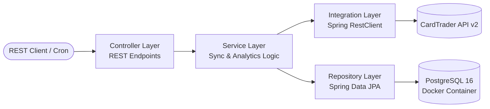
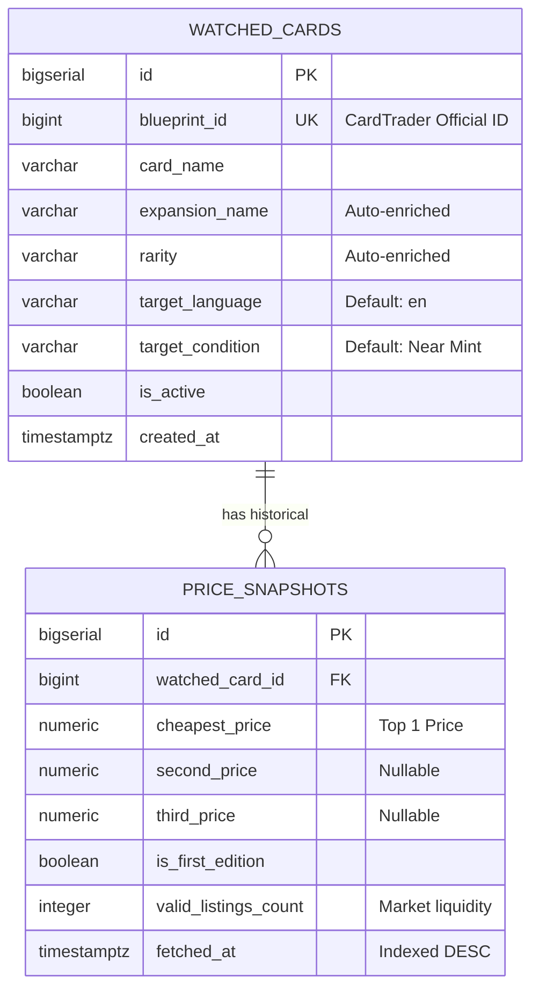

# 🃏 TCG Market Tracker & Price Analytics API


An enterprise-grade **RESTful API and automated market intelligence engine** for Trading Card Games (Yu-Gi-Oh!), integrated with the **CardTrader Marketplace API v2**. 

This project evolved from legacy CLI Python/CSV automation scripts into a resilient, scalable **Java 21 + Spring Boot** backend service backed by **PostgreSQL**, featuring automated price harvesting, smart listing filtration, moving-average analytics (7-day and 30-day windows), and market volatility alerts.

---

## ✨ Key Engineering Highlights

* **Financial Precision (`BigDecimal`):** All monetary conversions (cents to currency) and percentage variation formulas strictly use `BigDecimal` with `RoundingMode.HALF_UP`, preventing IEEE 754 floating-point inaccuracies.
* **Smart Marketplace Filtering Engine:** Automatically filters raw external marketplace payloads using Java Streams to isolate **English (`EN`)** and **Near Mint (`NM`)** listings while actively rejecting played/poor conditions and extracting `1st Edition` metadata.
* **Self-Healing Domain Metadata:** Watched cards registered only by `blueprintId` and `cardName` are automatically enriched with official `rarity` and `expansionName` attributes upon the first successful synchronization.
* **Database-Driven Moving Averages:** Historical analytics (`START`, `PREV`, `TODAY`, `7d AVG`, `30d AVG`) are computed using indexed PostgreSQL queries (`idx_price_snapshots_card_fetched`) rather than loading full history into application memory.
* **Schema Version Control:** Managed via **Flyway** (`V1` schema creation & composite indexes, `V2` initial 25-card watchlist seeding) paired with Hibernate `ddl-auto: validate` and `open-in-view: false`.
* **RFC 7807 Error Handling:** Centralized `@RestControllerAdvice` returning standardized `ProblemDetail` payloads for `404 Not Found`, `409 Conflict`, and `400 Bad Request` validation errors.

---

## 🏗️ System Architecture & Data Model

### Layered Architecture Flow



### Entity-Relationship Diagram (ERD)



---

## 🚀 Getting Started

### Prerequisites
* **JDK 21**
* **Docker & Docker Compose**
* A valid **CardTrader API v2 JWT Bearer Token**

### 1. Clone the Repository & Configure Environment
```bash
git clone [https://github.com/raphael-araripe/tcg-market-tracker-api.git](https://github.com/raphael-araripe/tcg-market-tracker-api.git)
cd tcg-market-tracker-api
```

Export your CardTrader API token in your terminal session:
```powershell
# PowerShell (Windows)
$env:CARDTRADER_TOKEN="your_jwt_token_here"

# Bash (Linux/macOS)
export CARDTRADER_TOKEN="your_jwt_token_here"
```

### 2. Start PostgreSQL Container
```bash
docker compose up -d
```

### 3. Run the Application
Flyway will automatically execute `V1__create_initial_schema.sql` and seed the initial 25 Yu-Gi-Oh! cards via `V2__seed_initial_watchlist.sql`:
```bash
./mvnw spring-boot:run
```
The server will start on **`http://localhost:8081`**.

### 4. Run Automated Unit Tests
```bash
./mvnw test
```

---

## 📡 API Reference (Port `8081`)

### 1. Watchlist Management (`/api/v1/cards`)
| Method | Endpoint | Description |
| :--- | :--- | :--- |
| `GET` | `/api/v1/cards?onlyActive=true` | Lists all monitored cards in the watchlist. |
| `GET` | `/api/v1/cards/{id}` | Retrieves details of a specific watched card. |
| `POST` | `/api/v1/cards` | Registers a new card (`blueprintId`, `cardName`). |
| `PATCH` | `/api/v1/cards/{id}/active?active=false` | Pauses or resumes price tracking for a card. |
| `DELETE` | `/api/v1/cards/{id}` | Deletes a card and cascades its snapshots. |

### 2. Market Synchronization (`/api/v1/sync`)
| Method | Endpoint | Description |
| :--- | :--- | :--- |
| `POST` | `/api/v1/sync` | Triggers an immediate market harvest across all active cards (also runs automatically every 6 hours via `@Scheduled`). |

### 3. Price Analytics & Moving Averages (`/api/v1/analytics`)
| Method | Endpoint | Description |
| :--- | :--- | :--- |
| `GET` | `/api/v1/analytics/summary` | Generates a full market report for all active cards (`initialPrice`, `previousPrice`, `currentPrice`, `avgPrice7d`, `avgPrice30d`, `%` variations, and `marketTrend`). |
| `GET` | `/api/v1/analytics/cards/{id}` | Returns the historical analytics report for a single card. |

#### Sample Analytics Response (`GET /api/v1/analytics/cards/1`)
```json
{
  "watchedCardId": 1,
  "blueprintId": 245836,
  "cardName": "Blue-Eyes White Dragon",
  "rarity": "Quarter Century Secret Rare",
  "expansionName": "Legendary Collection: 25th Anniversary Edition",
  "conditionDisplay": "NM",
  "initialPrice": 125.00,
  "previousPrice": 118.50,
  "currentPrice": 114.07,
  "avgPrice7d": 116.80,
  "avgPrice30d": 120.40,
  "varFromInitialPct": -8.74,
  "varFromPreviousPct": -3.74,
  "varFrom7dAvgPct": -2.34,
  "varFrom30dAvgPct": -5.26,
  "marketTrend": "PRICE_DROP_ALERT",
  "validListingsCount": 12,
  "totalSnapshots": 14,
  "lastUpdated": "2026-11-05T19:14:44.843-03:00"
}
```

---

## 📄 License
Distributed under the **MIT License**. See `LICENSE` for more information.
